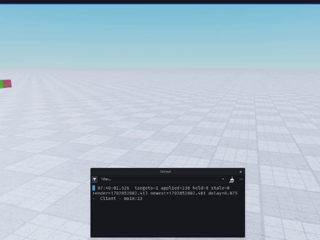

# Nerp

Interpolation for server driven transforms and the server stamps a `CFrame` with a time, the client buffers it and plays it back slightly late, so 20Hz of updates becomes continuous motion at your framerate.

It does not do any networking. You simply send the batch, then you receive it.



## Install

**Wally**

```toml
[dependencies]
Nerp = "superdupernairobi/nerp@0.2.0"
```
**Studio users:** download `Nerp.rbxm` from the latest releasse and right click `ReplicatedStorage` and pick Insert > Import Roblox Model

## Use
```lua
local Nerp = require(game:GetService("ReplicatedStorage").Nerp)

local store = Nerp.new(20, "SMOOTH") -- OR LOW_LATENCY
store:track(workspace.with_nerp)
store:start()

remote.OnClientEvent:Connect(function(t, cf)
    store:feed(workspace.with_nerp:GetFullName(), { { t = t, cf = cf } })
end)
```

## Extrapolation
Off by default. Pass it when a hold is more visible than a short guess:

```lua
local store = Nerp.new(20, "LOW_LATENCY", { extrapolate = 0.08 })
```
The clock may run up to 80ms past the newest sample before holding. The highest is 0.1 seconds.

## Lag compensation
`Nerp.history()` is a server-sided ring of what you recorded.
```lua
local h = Nerp.history()
h:record(player.Name, now, root.CFrame)

for _, entry in h:rewind(now - 0.12) do
    -- raycast against entry.cf
end
```

# The delay is a multiple and not a time
`"SMOOTH"` is two samples of intervals, `"LOW_LATENCY"` is one and a half, so, at 20Hz that is 100ms and 75ms.

Basically, two intervals leaves one whole sample of slack, so a single late packet still has a pair to interpolate between. At one interval the clock sits on the newest sample and any jitter pushes it past the end, which is where extrapolation starts. `LOW_LATENCY` is the one that can extrapolate, so it is for close combat and not for vehicles.

## What it isn't
No lag comp, no bandwidth work, no camera, no prediction, Roblox already interpolates player characters, so Neerp does not do that by default.

## Links
- Docs: https://superdupernairobi.github.io/Nerp/
- Wally: https://wally.run/package/superdupernairobi/nerp