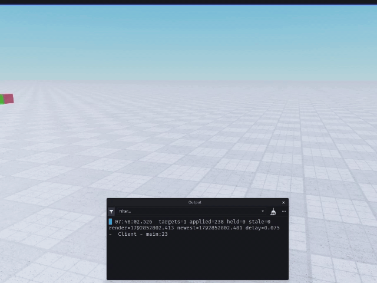

# Example

Two parts same motion, one streamed.

| part           | how it moves                                                                                                    |
|----------------|-----------------------------------------------------------------------------------------------------------------|
| `without_nerp` | the server sets it's `CFrame` at 20Hz and replication does the rest                                             |
| `with_nerp`    | thee server sends a timestamped `CFrame` on a `UnreliableReemoteEvent` at 20Hz, nerp interpolates on the client |



Both parts are anchored, an unanchored part is owned by physics on the client and the write gets deleted.

## Server part
```lua
local now = Workspace:GetServerTimeNow()
local cf = CFrame.new(Vector3.new(math.cos(angle) * RADIUS, 6, math.sin(angle) * RADIUS))

withoutNerp.CFrame = cf
remote:FireAllClients(now, cf)
```

## Client part

```lua
local store = Nerp.new(20, "LOW_LATENCY") -- OR "SMOOTH"
store:track(withNerp)
store:start()

remote.OnClientEvent:Connect(function(t, ct)
    store:feed(withNerp:GetFullName(), { { t = t, ct = ct } })
end)
```
The ID has to match, `track` keeys on `GetFullName()` so a feed that sends `part.Name` is ignored.